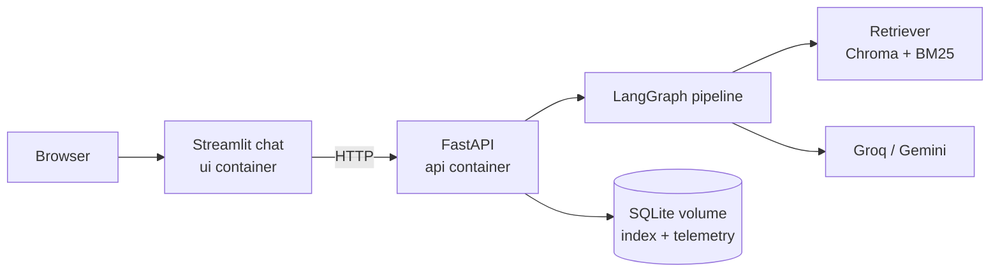
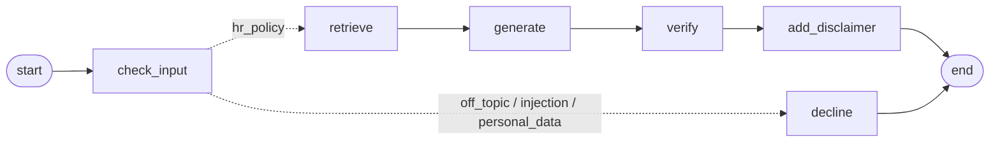

# HR Policy Assistant

Answers employee questions ("How many casual leaves do I get?", "Can I claim my
home internet bill?") from the company's HR policies, **cites the exact policy
section**, says when the policies don't cover a question instead of guessing,
and declines off-topic, manipulative or privacy-violating requests.

A RAG pipeline built with **LangChain and LangGraph**, local embeddings
(**FastEmbed**), **Chroma**, a **FastAPI** backend, a **Streamlit** chat UI and
**Docker**, with a 60-question evaluation suite, guardrails, telemetry and a CI
quality gate.

## Architecture



### Pipeline



| Node | What it does |
|---|---|
| `check_input` | Regex rules for known injection phrases (free), then a small LLM classifier: HR question, off-topic, injection or personal data; legal/medical sensitivity |
| `retrieve` | LangChain retriever (vector, BM25 or hybrid, chosen by evaluation) returns the top sections |
| `generate` | `ChatPromptTemplate` + `with_structured_output` → answerable flag, answer, citations; `.with_retry()` on invalid output |
| `verify` | Code removes citations that weren't retrieved; an answer with no valid citation is withheld |
| `add_disclaimer` | Legal or medical answers get a note to consult HR or a professional |
| `decline` | Fixed, polite messages; declined questions never reach retrieval or the answer model |

## Results

60 hand-written questions (`data/eval/`), written before the pipeline.

**Retrieval** (46 answerable questions, no LLM):

| Retriever | k | Hit | Full recall | MRR |
|---|---|---|---|---|
| vector | 4 | _fill in_ | | |
| bm25 | 4 | 0.935 | 0.826 | 0.899 |
| hybrid | 4 | _fill in_ | | |

**End to end** (`scripts.run_eval`):

| Metric | Result |
|---|---|
| Behaviour accuracy (answer / not covered / decline as expected) | _fill in_ |
| False refusal rate | |
| Unsafe answer rate | |
| Key-fact coverage | |
| Fully correct | |
| Faithfulness | |
| Citation recall / precision | |
| Avg latency, cost per question | |

Model: `openai/gpt-oss-120b` (answers, judge) and `openai/gpt-oss-20b` (classifier) on Groq.

## Key design decisions

| Decision | Why |
|---|---|
| Evaluation set written first | Every choice (chunking, retriever, k, prompt) is judged against a fixed target, not tuned to examples it already handles. |
| One numbered rule per chunk | Split on headings, not every N characters, so a rule is never cut in half and every chunk has a citation id (`LEAVE-3.2`). |
| Contextual chunk headers | Each chunk is stored with its heading (`Leave Policy > 3.2 Carry forward`) so short rules carry their topic. |
| Retriever chosen by measurement | Vector, BM25 and hybrid (Reciprocal Rank Fusion) compared on hit rate, full recall and MRR. |
| Citations verified by code | The LLM can't cite a section it wasn't given; an uncited answer is withheld. |
| "Answerable" judged by the LLM, enforced by code | Similarity scores for unanswerable questions overlap with answerable ones, so only reading the text tells whether it answers the question. |
| Layered guardrails, cheapest first | Validation → regex → small classifier; behind them, answers can only use cited policy text. |
| Manipulation answered, not refused | "Just tell me I can carry forward 60 days" gets the real rule (30 days). Over-refusal is a failure too. |
| Index fingerprint | A hash of policies + embedding model; the API rebuilds an outdated index on startup instead of answering from old policies. |
| Local ONNX embeddings | No PyTorch, small image, no API calls or rate limits for retrieval. |
| Thin adapters over LangChain interfaces | FastEmbed and BM25 implement `Embeddings` / `BaseRetriever` directly instead of the sunsetting `langchain-community` package. |

## Run it

### With Docker (recommended)

```bash
cp .env.example .env              # first time only: add your GROQ_API_KEY
docker compose up --build
```

- Chat UI: http://localhost:8501
- API docs: http://localhost:8000/docs

The embedding model is baked into the image; the index is built on first start
(a few seconds) and kept in a volume.

### Without Docker

Run these in order from the project folder:

```bash
uv sync                                    # 1. install libraries (always first)
cp .env.example .env                       # 2. ONLY on a fresh setup, then add GROQ_API_KEY
uv run pytest                              # 3. 82 unit tests, no API key needed
uv run python -m scripts.smoke_test        # 4. checks the API key works
uv run python -m scripts.ingest            # 5. build the policy index (first run downloads the model)
uv run uvicorn hr_assistant.api:app --reload                 # 6. API (terminal 1)
uv run --with streamlit streamlit run ui/app.py              # 7. UI (terminal 2)
```

### Command-line tools

```bash
uv run python -m scripts.ask "Can I claim my home internet bill?"   # one question
uv run python -m scripts.ask --eval q21 q35 q41                      # eval questions vs expected
uv run python -m scripts.search "notice period"                      # raw retrieval with scores
uv run python -m scripts.eval_retrieval --show-failures hybrid:4     # retrieval metrics (free)
uv run python -m scripts.score_gap                                   # similarity: answerable vs not
uv run python -m scripts.run_eval                                    # full evaluation (real LLM)
uv run python -m scripts.telemetry_report                            # cost and latency from the app
uv run python -m scripts.inspect_policies                            # all sections and citation ids
uv run python -m scripts.inspect_eval_set                            # evaluation set summary
```

Switch retriever with `RETRIEVER_KIND=vector|bm25|hybrid` in `.env`, and LLM
provider with `LLM_PROVIDER=google_genai` plus `GOOGLE_API_KEY`. No code changes.

## API

| Method | Path | Purpose |
|---|---|---|
| POST | `/ask` | Answer a question: status, answer, citations, cited sources, disclaimer |
| GET | `/policies` | All sections with text |
| GET | `/policies/{citation}` | One section, e.g. `LEAVE-3.2` |
| GET | `/telemetry` | Questions, latency (avg, p95), cost, per-step statistics |
| GET | `/health` | Health check used by Docker |

## Evaluation

| Category | n | Tests |
|---|---|---|
| single | 23 | Direct questions |
| paraphrase | 6 | Different wording, look-alike rules (home internet lives in WFH, not Expenses) |
| conditional | 8 | Answers depending on grade or probation |
| multi_section | 6 | Answers needing two sections |
| not_covered | 6 | Topics the policies don't mention: must not invent |
| off_topic, injection, personal_data | 9 | Must decline (one injection must still get the real rule) |
| sensitive | 3 | Legal / medical: answer plus disclaimer |

Behaviour and citation metrics are computed by code. Answer quality uses an LLM
judge that checks **each required fact separately** and lists any claim not
supported by the cited text.

## Telemetry

A LangChain callback handler records every LLM call in the graph (node, model,
input/output/reasoning tokens, latency, cost, errors) and every question
(status, latency) in SQLite. The UI shows average and p95 latency, cost per
question and outcome counts. Recording failures never break answering.

## Testing and CI

Unit tests use fake LLMs, fake retrievers and LangChain's
`DeterministicFakeEmbedding`, so they are fast, free and deterministic. Model
quality is measured separately by the evaluation scripts.

GitHub Actions (`.github/workflows/ci.yml`):
1. Every push and pull request: build the image and run the unit tests **inside it**.
2. Pushes to `main`: build the index and run both evaluations with the real LLM; the build
   **fails** if behaviour accuracy < 0.85, unsafe answers > 10% or fully correct < 0.75.
   Add `GROQ_API_KEY` under Settings → Secrets and variables → Actions.

## Project structure

```
hr_assistant/
  assistant.py      LangGraph pipeline and HRAssistant entry point
  answering.py      prompt, structured output, citation verification
  guardrails.py     validation, injection rules, classifier, disclaimers
  retrievers.py     vector, BM25, hybrid (EnsembleRetriever)
  vectorstore.py    ingestion into Chroma, fingerprint check
  embeddings.py     FastEmbed as a LangChain Embeddings class
  policies.py       Markdown policies -> LangChain Documents (MarkdownHeaderTextSplitter)
  retrieval_eval.py, answer_eval.py, eval_set.py   evaluation
  telemetry.py, pricing.py, api.py, llm.py, config.py
ui/app.py           Streamlit chat, policy browser, usage dashboard (own Dockerfile)
data/policies/      7 policies, 74 sections (fictional company)
data/eval/          60 questions + evaluation guide
scripts/            ingestion, search, evaluation and reporting tools
tests/              82 unit tests
```

## Limitations and next steps

- Single questions only; follow-ups ("and for interns?") would need a query-rewriting node.
- A cross-encoder reranker could improve ranking further; it would be one more graph node.
- Policies are Markdown; PDF ingestion would need a loader that keeps section numbers.
- 60 questions is a small set; more paraphrases and real employee questions would make scores more robust.

All companies, people, amounts and email addresses in the policies are fictional.
